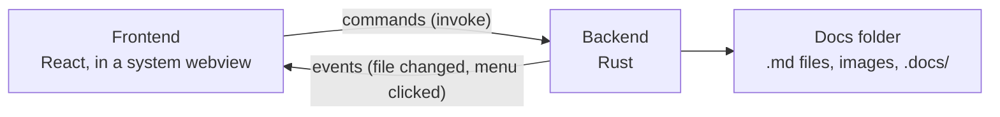
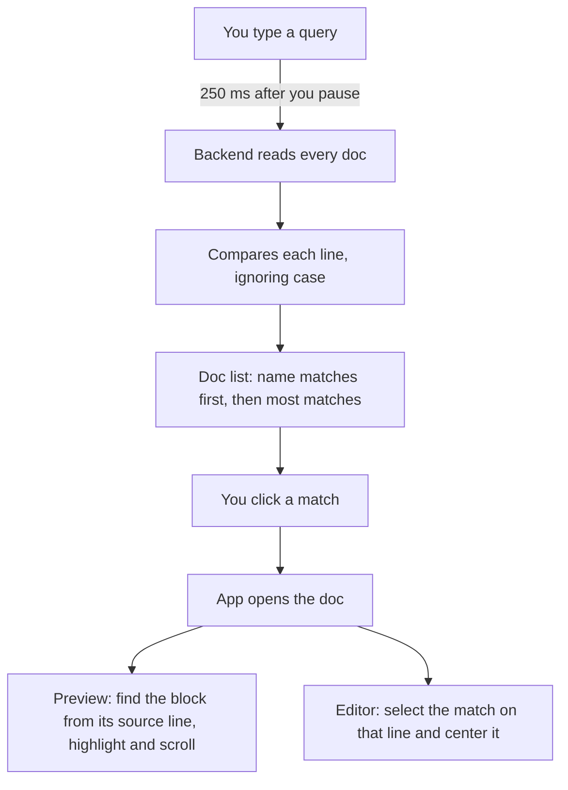
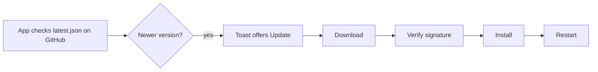

# How Markdown Docs works

A guide to every feature: what it does for you, how it works underneath, what it's built with, and where the code lives. It's for anyone using the app who is curious, and for anyone changing the code.

For installing and building, see the [README](../README.md).

## The big picture

Markdown Docs is a desktop app for macOS and Linux. Your docs are ordinary `.md` files in a folder. The app reads, writes and adds to them; it never hides them in a private format.

It has two halves that talk to each other:



- **The backend** does everything that touches the disk: reading and saving files, searching, moving docs, comments, version history, and turning Markdown into safe HTML.
- **The frontend** is the interface: the sidebar, editor, preview and panels. It calls the backend through typed wrappers in `src/lib/api.ts`.

### What we use

| Part | Technology | What it does here |
| --- | --- | --- |
| App shell | [Tauri 2](https://tauri.app) | Native window, menus, and the bridge between frontend and backend. It uses the system's webview (WKWebView on macOS, WebKitGTK on Linux), which keeps the app around 10 MB. |
| Interface | React 19, TypeScript, Vite | The UI and its build |
| UI components | shadcn/ui, Base UI, Tailwind CSS 4, lucide icons | Buttons, menus, dialogs and styling |
| Search palette | cmdk | The Ctrl/⌘K list and its keyboard handling |
| Notifications | sonner | Toast messages |
| Editor | CodeMirror 6 | Markdown editing, undo, and the search engine behind find and replace |
| Markdown to HTML | comrak (Rust) | GitHub-flavored Markdown, math markers, front matter, source positions |
| HTML safety | ammonia (Rust) | Strips scripts and anything else unsafe from the HTML |
| Code highlighting | highlight.js | Colors code blocks in the preview |
| Math and diagrams | KaTeX, Mermaid | Rendered in the frontend after the HTML arrives |
| Properties | js-yaml | Reads the YAML block at the top of a doc |
| Comments storage | SQLite, through rusqlite | One small database inside the docs folder |
| File watching | notify (Rust) | Notices changes made outside the app |
| Deleting | trash (Rust) | Sends files to the system Trash instead of erasing them |
| Dates | chrono (Rust) | Local dates for properties and templates |
| Updates | tauri-plugin-updater | Downloads and verifies new versions |
| Fonts | Fontsource (bundled) | Geist, Fraunces, Newsreader, IBM Plex Mono, so the app looks the same offline |

### Where things are stored

```
Docs/                       your docs folder
├── welcome.md              a doc is a plain Markdown file
├── team/
│   ├── standup.md
│   └── img/shot.png        pasted images go beside the doc
└── .docs/                  the app's own data, hidden from the sidebar
    ├── comments.db         all comment threads
    ├── history/            earlier versions of each doc
    ├── templates/          templates for new docs
    └── properties-added    marks that existing docs have been given properties
```

Because `.docs/` sits inside the docs folder, copying or syncing the folder brings comments, history and templates along.

Preferences live separately in the app's data folder: `settings.json` for preferences and `location.json` for your chosen docs folder. Recent docs and recent searches are kept per computer in the webview's local storage.

A doc's **id** is its path without `.md`, such as `team/standup`. Ids are how the frontend, comments and history refer to a doc.

---

## Writing and viewing

### Docs and folders

Name a doc `team/standup` and it's created inside a `team` folder. The sidebar is built by walking the docs folder for `.md` files, skipping anything starting with a dot and any folder with no docs in it. Sorting is natural, so `2` comes before `10`.

Every path from the frontend is checked before use: it's resolved to a real location and refused if that lands outside the docs folder. That blocks `../` tricks and symlinks that point out of the folder.

**Code:** `src-tauri/src/docs.rs`, `src/components/Sidebar.tsx`

### The editor and the three views

- **Preview** shows the rendered doc.
- **Markdown** shows the source in CodeMirror.
- **Split** shows both, re-rendering 200 ms after you stop typing.

**Code:** `src/components/Editor.tsx`, `src/components/DocHeader.tsx`

### Saving

1. A second after you stop typing, the app saves. Ctrl/⌘S saves right away.
2. The text goes to a temporary file, which is then renamed over the original. A crash mid-save can't leave a half-written doc.
3. Before writing, the app compares the file's modified time with the one it saw on opening. If another program changed the file, it asks before overwriting.
4. If you decline or a save fails, autosave pauses and a Save button appears.

**Code:** `save` and `write_atomic` in `docs.rs`, `save` in `src/App.tsx`

### Changes made outside the app

A file watcher tells the frontend when something changes. Bursts of events are combined, then the sidebar refreshes and the open doc reloads, unless you have unsaved edits, which always win. Changes inside hidden folders are ignored, so the app's own `.docs/` writes don't trigger reloads.

**Code:** `watch` in `src-tauri/src/main.rs`, `syncFromDisk` in `App.tsx`

### How the preview is rendered

1. **comrak** turns Markdown into HTML in Rust: tables, task lists, strikethrough, autolinks, footnotes and math.
2. **ammonia** sanitizes that HTML. Raw HTML in a doc is allowed, but scripts and event handlers are removed.
3. The frontend then **enhances** it: local images are pointed at the real files, code is colored with highlight.js, math is drawn with KaTeX, and Mermaid draws diagrams in its strict security mode.

The app's content security policy also blocks outside scripts, as a second layer.

**Code:** `render` in `docs.rs`, `enhance` in `src/lib/preview.ts`

### Links and images

A link like `[setup](../guides/setup.md#install)` opens that doc at that heading. `#anchors` scroll the preview, and web links open in your browser. Links never navigate the app window itself.

**Code:** `src/lib/links.ts`

### Viewing images up close

Click an image or Mermaid diagram in the preview to open it full-window.

- **Fit and zoom:** it opens fitted to the window. Click it to see it at actual size and click again to fit, or use the zoom buttons, + and −, 0 to fit, or Ctrl/⌘ with the scroll wheel, which zooms around the pointer.
- **Moving around:** drag to pan a zoomed image. ← and → step through every image and diagram in the doc. Esc or a click outside closes it.
- **Diagrams** are vector, so they grow to fill the window. The app copies the rendered diagram, sizes it from its viewBox and shows it as an SVG image on the app's background, so its text stays readable.
- **Images inside links** follow the link instead.

**Code:** `src/components/ImageViewer.tsx`, `viewerImages` in `preview.ts`

### Pasting and dropping images

Paste a screenshot or drag image files into the editor. They're saved to an `img/` folder beside the doc and linked at the cursor. File names are cleaned up, and an existing file is never overwritten: a second `shot.png` becomes `shot-2.png`.

Each platform needs its own route:
- **macOS:** the image bytes arrive in the paste event.
- **Linux:** WebKitGTK's paste event is empty for images, so the backend reads the GTK clipboard directly.
- **Files dragged from outside:** Tauri hands over file paths, and the backend copies them.

**Code:** `save_image` in `docs.rs`, paste handling in `Editor.tsx`

### Moving and renaming

Drag a doc or folder in the sidebar, or use Rename. Nothing is ever overwritten. After the move, the app:

1. Scans every doc's links and images, skipping code blocks and code spans.
2. Rewrites relative links so they still point at the same files, both inside the moved doc and in docs linking to it.
3. Moves the comments and version history along.

**Code:** `relocate` in `docs.rs`, `src-tauri/src/relink.rs`

---

## Finding things

### Search (Ctrl/⌘K)

The popup opens with your recent searches and doesn't search until you type. It then looks through doc names and text, and lists each doc with a match count and up to 5 matching lines, with the match highlighted. Clicking a line takes you to that exact match; clicking the doc name goes to its first match.



**Waiting for a pause (debounce):** each search reads every doc, so the app waits until you've stopped typing for 250 ms. Each keystroke cancels the pending search, and a late answer to an older query is ignored.

**Recent searches:** a term is remembered when you open one of its results, not on every keystroke, so half-typed words don't pile up. The last 10 are kept in the webview's local storage, so they stay on this computer and never go into your docs folder. Remove one with the × in the popup, or manage them in **Settings → Search**.

**How matching works**

- **By line, as you'd read it.** Each line is first compared without its Markdown symbols: bold and code markers, heading and list prefixes, and link addresses are removed. So `the big docs` finds `**the big** [docs](https://example.com)`.
- **Then as written.** If that finds nothing on a line, the raw line is checked, which is how `example.com` still finds that link.
- **Properties.** Only values are searched, not names, or `status` would match every doc. A property match only appears when the doc's body has no match.
- **Ranking and limits.** Docs whose name matches come first, then those with the most matches. Up to 50 docs are shown.

**How clicking finds the right spot in the preview**

The source line number alone isn't enough, because the preview is HTML. So comrak's `sourcepos` option stamps each rendered element with the source lines it came from, such as `data-sourcepos="332:1-332:34"`. The app then:

1. Finds the innermost block covering that line. Inline elements like bold are skipped, because they only hold part of a line.
2. Counts how many earlier occurrences that block has, to pick the right one when a word repeats.
3. Highlights it and scrolls to it.

The highlight uses the browser's **CSS Custom Highlight API**, which paints text without changing the page. That matters because comment positions depend on the page text staying exactly as it is.

**Limits**

- Search reads saved files on every query, so it's instant for hundreds of docs but isn't built for tens of thousands.
- A phrase split across two source lines won't match.
- A match inside a Mermaid diagram scrolls near it rather than highlighting the word.

**Code:** `search`, `doc_matches` and `plain_line` in `docs.rs`, `src/components/SearchDialog.tsx`, `locateMatch` in `preview.ts`, `revealInEditor` in `Editor.tsx`

### Find and replace in a doc

Ctrl/⌘F opens a bar with match case, a match count, and next/previous. Ctrl+H (⌥⌘F on macOS) adds replace.

- **In the editor,** CodeMirror's search engine does the work. Its built-in panel is kept hidden, since CodeMirror only highlights matches while a panel is open, and the app's own bar drives it.
- **In Preview,** the app searches the rendered text and paints matches with the CSS Custom Highlight API.
- **Replacing** changes the Markdown, so from Preview it opens Split view first.

**Code:** `src/components/FindBar.tsx`, `findAll` in `preview.ts`

### Table of contents

Built from the h1 to h4 headings in the preview. As you scroll, the current section is marked.

---

## Organizing with metadata

### Properties (YAML front matter)

A doc can start with a block of properties:

```yaml
---
title: "Kickoff"
description: ""
tags: [meeting]
status: draft
created: 2026-10-29
updated: 2026-10-29
attendees: []
---
```

- **In Preview,** a card above the doc shows status, tags, dates, description and any extra fields. The title only appears if it differs from the first heading.
- **Rendering:** comrak's front matter option keeps the block out of the rendered doc, so it isn't in PDFs and doesn't affect comment positions. js-yaml reads it for the card, with date parsing turned off so dates stay as written.
- **Saving** sets `updated` to today by changing that one line. The editor applies the change as a small edit, so your cursor doesn't move.
- **Existing docs:** the first time the app opens a docs folder, each doc without a block gets one, with the title from its first heading or file name and dates from the file. The original goes into version history first. The `properties-added` marker stops this running twice, and a doc added later can use **⋯ → Add properties**.

**Code:** `src-tauri/src/meta.rs`, `src/lib/properties.ts`, `src/components/PropertiesCard.tsx`

### Templates

Templates are plain `.md` files in `.docs/templates/`. The first time they're needed, the app writes four starters: Blank, Daily note, Meeting notes and Spec. After that the folder is yours to edit.

The New doc dialog lets you pick one. `{{title}}`, `{{date}}` and `{{time}}` are filled in on creation, and the title is escaped inside the YAML so a name with quotes can't break it. **⋯ → Save as template…** turns a doc into a template, replacing its title and dates with placeholders.

**Code:** `meta.rs`, `src/components/NameDialog.tsx`

### Word count

The header shows the word count, with reading time on hover (about 230 words a minute). Link addresses, image paths, HTML tags, task checkboxes and properties don't count. Chinese and Japanese characters count one each, since those languages don't put spaces between words.

**Code:** `src/lib/words.ts`

---

## Keeping work safe

### Version history

Open the **History** tab to see earlier versions by day.

**When a version is kept:** just before a save overwrites a doc, the text being replaced is copied to `.docs/history/<doc file>/<time in ms>.md`. This happens at most once every 5 minutes, and identical text is skipped. The file is named after the time that text was saved, so the label is accurate even if you come back hours later.

**How long versions are kept:**

| Age | Kept |
| --- | --- |
| Up to a day | Everything |
| Up to a week | One per hour |
| Up to 90 days | One per day |
| Older | One per week |

**Viewing:** **Changes** compares a version with the current text, line by line, using a longest-common-subsequence diff. Unchanged stretches fold away. **Preview** shows how it looked.

**Restoring:** the current text is always saved as a version first, so a restore can be undone.

**Worth knowing:**
- Only saves made in the app create versions.
- Renames and moves keep history. Deleting a doc drops its history.
- Restoring doesn't change comments.

**Code:** `src-tauri/src/history.rs`, `restore` in `docs.rs`, `src/components/History.tsx`, `src/lib/diff.ts`

### Deleting

Docs and folders go to the system Trash, so a mistaken delete can be recovered. Comments and version history for them are removed.

---

## Comments

Select text in the preview and click **Comment**, or add a general note. Threads support replies, edits, deletion and resolve/reopen, and comment text is Markdown.

**How a comment stays attached to its text:** each one stores the quoted text and its character position in the preview's text. To place the highlight, the app checks that position first, then falls back to the first place the quote appears. If the quote is gone, the thread is flagged. Comments are kept out of your `.md` files, in `.docs/comments.db`.

**Worth knowing:** comments are lost if a doc is renamed or moved outside the app, because they follow the doc's id. Two computers editing comments at once in a synced folder can produce a conflicted copy of the database.

**Code:** `src-tauri/src/comments.rs`, `src/components/CommentsPanel.tsx`, `anchor` in `preview.ts`

---

## Layout and appearance

- **Panels:** hide the sidebar (Ctrl/⌘+\\) or the right panel (Ctrl/⌘+Shift+\\), and drag their edges to resize. Widths are remembered.
- **Focus mode** (Ctrl/⌘+Shift+F) hides both panels.
- **Narrow windows:** below 1040 px wide, the right panel opens over the doc.
- **Theme:** the paper-and-ink look follows your system's light or dark setting. Colors and fonts are CSS variables in `src/index.css`.
- **Fonts:** Settings lets you pick any installed font. The list comes from CoreText on macOS and `fc-list` on Linux.
- **Linux menus:** Cut, Copy and Paste run WebKit's editing commands directly, because the default menu items fake keystrokes in a way that does nothing on Wayland.

**Export PDF** (Ctrl/⌘P) uses the system print dialog, with print styles that leave only the rendered doc.

**Code:** `src/components/ResizeHandle.tsx`, `src/components/SettingsPage.tsx`, `src/lib/settings.ts`

---

## Choosing a docs folder

Settings can point the app at any folder, including one kept in sync by Dropbox, Google Drive or Syncthing. When switching, it can copy your current docs across, and copying stops before starting if any file would clash. The old folder is left as it was. If the chosen folder is missing at launch, such as an unplugged drive, the app opens the default one and tells you.

Switching to a folder for the first time also adds properties to any docs there that lack them.

---

## Updates and releases

### In-app updates



Nothing installs without asking. Each update is signed with a private key held only as a GitHub secret, and the app checks it against the public key in `tauri.conf.json`, so a tampered download is refused. On a `.deb` install you're asked for your password, since the package is installed system-wide.

**Code:** `src/lib/updates.ts`

### How a release is built

Pushing a `v*` tag runs `.github/workflows/release.yml`:

1. Builds a universal macOS app and Linux `.deb` and `.AppImage`.
2. Signs the update files.
3. Generates `latest.json` with `.github/scripts/latest-json.mjs`.
4. Publishes everything as one GitHub Release, with checksums.

Two other workflows: `ci.yml` runs the tests on every branch push, and `pages.yml` publishes the `website/` folder to GitHub Pages.

---

## Code map

```
src/                        Frontend
├── App.tsx                 Layout, open doc state, save, modes, wiring
├── components/
│   ├── Sidebar.tsx         Doc tree, drag to move
│   ├── DocHeader.tsx       Top bar, view switch, ⋯ menu, word count
│   ├── Editor.tsx          CodeMirror, image paste and drop
│   ├── FindBar.tsx         Find and replace
│   ├── ImageViewer.tsx     Full-window image and diagram viewer
│   ├── SearchDialog.tsx    Ctrl/⌘K search
│   ├── History.tsx         Version list, changes view
│   ├── CommentsPanel.tsx   Comment threads
│   ├── PropertiesCard.tsx  Properties above the preview
│   ├── NameDialog.tsx      Name prompt and template picker
│   ├── SettingsPage.tsx    Settings
│   └── Welcome.tsx         Start screen
└── lib/
    ├── api.ts              Typed calls to the backend
    ├── preview.ts          Enhancing HTML, highlights, locating matches
    ├── properties.ts       Reading and updating the YAML block
    ├── diff.ts             Line diff
    ├── words.ts            Word count
    ├── links.ts            Relative links and image paths
    ├── settings.ts         Preferences and fonts
    └── updates.ts          Update check and install

src-tauri/src/              Backend
├── main.rs                 Commands, menus, file watcher
├── docs.rs                 Files, search, saving, moving, rendering
├── history.rs              Version snapshots and thinning
├── meta.rs                 Properties and templates
├── relink.rs               Fixing links after moves
└── comments.rs             Comment database
```

## Running the tests

```sh
npm test                    # frontend (Vitest)
cd src-tauri && cargo test  # backend
```
